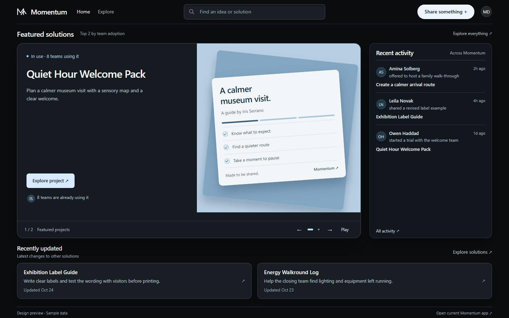
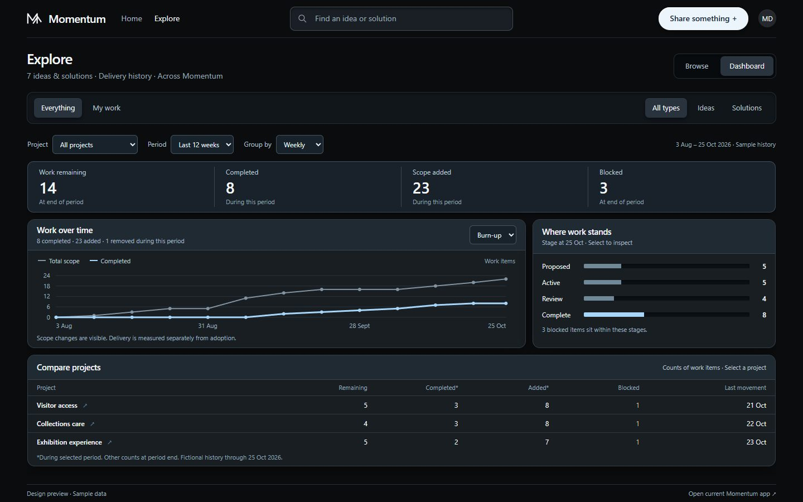

# Momentum

**Find useful solutions. Shape new ideas. See work move forward.**

Momentum brings a shared solution catalog, idea intake, review, and delivery visibility into one workspace. Discover what already works, contribute your perspective, and follow the work that matters to you.



## The experience

- **Home** showcases solutions ranked by usage, recent activity, and recently updated solutions outside the showcase.
- **Explore** brings discovery and personal work together. Switch between Everything and My work, then Browse or Dashboard without losing your filters.
- **Dashboard** shows scope, completion, blocked work, and stage movement across projects or within one project. Drill into the underlying work while keeping context.

<details>
<summary>See the delivery dashboard</summary>



</details>

### Design preview and application

The screenshots show the interactive [Momentum concept](src/Momentum.Frontend/apps/web/public/momentum-concept.html), available locally at **http://localhost:5100/apps/web/momentum-concept.html** after building the web app. It uses fictional museum projects and people. Delivery charts use dated demonstration events; saved items and other preview interactions are stored for the browser session.

The React application is served at **http://localhost:5100/apps/web/**. Its .NET service provides persistent submissions, catalog search, audience-aware comments, review decisions, and engagement records. The concept is the direction for the experience; its portfolio history and charts are not yet backed by production event storage.

The [experience brief](docs/design/momentum-experience-brief.txt) records the current layout, navigation, and data decisions.

## Run locally

You need the .NET SDK selected by [global.json](global.json), Node.js 20 or newer, pnpm 10.33, and Docker for the Aspire storage emulator. Azure Functions Core Tools enables the optional local Worker.

Build the frontend from the workspace:

```powershell
cd src/Momentum.Frontend
corepack enable
pnpm install --frozen-lockfile
pnpm build:apps
cd ../..
```

Start the local stack:

```powershell
dotnet run --project src/Momentum.AppHost
```

Aspire starts Azurite and the Service, and starts the Worker and frontend development process when their tools are available. Open the Service endpoint shown in the Aspire dashboard.

If Azurite is already running on its default ports, start just the Service:

```powershell
./scripts/web/start-http-dev.ps1
```

This serves the application and preview on port **5100** with development authentication. Run one hosting path at a time to avoid competing listeners. Development mode is for local use.

## How it works

```text
Browser / MCP client
        |
Momentum.Service  -->  Application  -->  Domain
        |                  |
        +------ Infrastructure ------+
                      |
             Azure Storage
           tables / queues / blobs
                      |
              Momentum.Worker
```

The Service exposes HTTP and MCP capabilities with shared business authorization. Tables hold business state, queues carry workflow events, and the queue-triggered Worker handles triage and publication.

| Location | Responsibility |
| --- | --- |
| `src/Momentum.AppHost` | Local Aspire composition |
| `src/Momentum.Service` | HTTP API, authentication, MCP, and static apps |
| `src/Momentum.Worker` | Queue-triggered workflow execution |
| `src/Momentum.Library` | Domain, Application, Runtime, and Infrastructure layers |
| `src/Momentum.Contracts` | Shared .NET contracts |
| `src/Momentum.Frontend/apps/web` | React/Vite application and standalone concept |
| `src/Momentum.Frontend/apps/docs` | Docusaurus documentation |
| `src/Momentum.Frontend/packages` | Contracts, SDK, logic, and UI packages |
| `tests/Momentum.Tests` | Backend tests |

## Configuration

Settings use the `MOMENTUM_` prefix. See [.env.example](.env.example) for names and examples; export settings into the host environment before starting the Service.

| Setting | Purpose |
| --- | --- |
| `MOMENTUM_STORAGE_CONNECTION_STRING` | Azure Storage connection; defaults to local Azurite |
| `MOMENTUM_AUTH_MODE` | `none`, `entra`, or `oauth` |
| `MOMENTUM_AUTH_ENTRA_*` | Entra tenant, client, audience, and redirect settings |
| `MOMENTUM_AUTH_OAUTH_*` | OAuth/OIDC issuer, client, scopes, and redirect settings |
| `MOMENTUM_SESSION_SECRET` | Session cookie signing secret |
| `MOMENTUM_AUTH_PRE_REGISTERED_CLIENTS` | Optional MCP OAuth client registrations |

`--dev` or the Development hosting environment disables authentication. Use a non-development environment and configured identity provider for deployment.

## Agent access

The MCP HTTP endpoint is **`/api/mcp`**. [.vscode/mcp.json](.vscode/mcp.json) connects to the local Service, and [.mcp.json](.mcp.json) provides the stdio configuration.

Available tools include `search_solutions`, `search_requests`, `get_request`, `create_request`, `add_comment`, `add_vote`, `accept_request`, and `reject_request`.

## Check changes

```powershell
dotnet test tests/Momentum.Tests/Momentum.Tests.csproj
cd src/Momentum.Frontend
pnpm build:apps
pnpm --filter @momentum/logic verify
```

The frontend build checks package types and builds the web application and documentation. For preview changes, also inspect Home, Explore, Dashboard, and drill-in behavior at desktop and narrow viewport sizes.

## Deploy

```powershell
docker build -t momentum .
docker run --env-file .env.production -p 8080:8080 momentum
```

Supply the storage connection, authentication settings, and session secret through your deployment environment. The image serves HTTP on port **8080**. Deploy the Worker separately for queue processing.

## License

MIT
